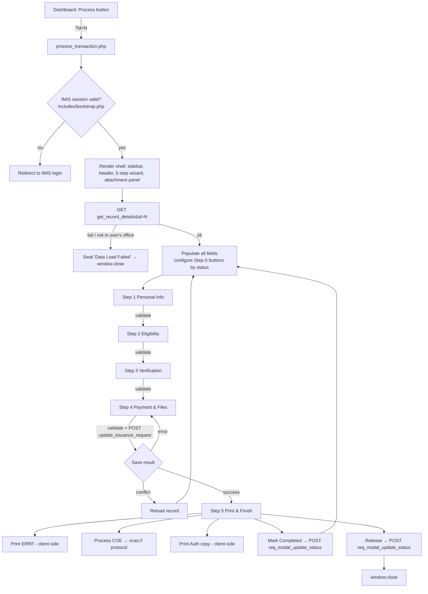
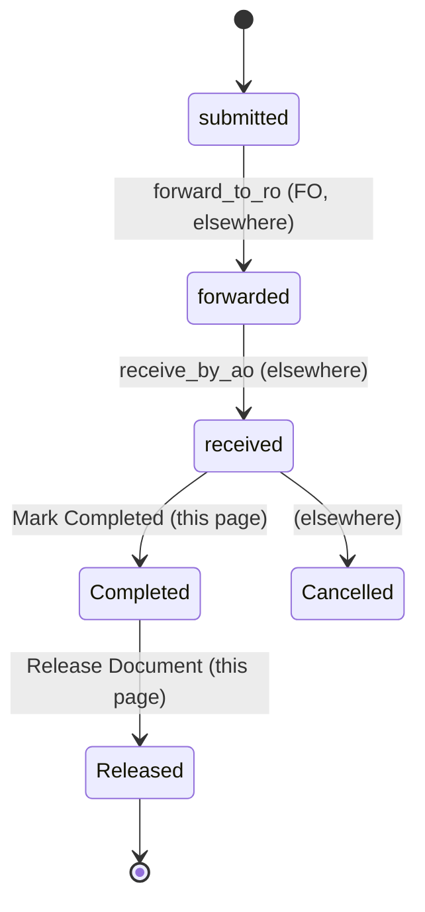

# Process Transaction — Process Flow (Re-engineering Guide)

**Subject:** `etts/views/esd/process_transaction.php` (2,197 lines: PHP shell + inline CSS + inline JS)
**Backend:** `etts/handlers/transaction_handler.php`
**Documented:** 2026-11-13, from the code as it stands in the local checkout
**Purpose:** A baseline for re-engineering this page. It records what the page does today, step by step, with the defects and design limits found along the way. Treat it as a description of current behaviour, not as a target design.

---

## 1. What the page is

It is a per-record **workspace** where an ESD processor completes one issuance transaction (Certification, Authentication, or Certification and Authentication). The processor:

1. checks the client's personal data and eligibility data against ML / ROE / ICSEVS,
2. records the verification references (book/page/sequence, certificate no., rating),
3. records payment (OR number, copy counts),
4. prints the ERRF, sends the data to VCAS, and prints the authenticated copy,
5. moves the record to **Completed**, then **Released**.

SPELS records do not use this page. They use `openSpelsModal()` on the dashboard.

### Entry point

| From | Condition | Link |
|---|---|---|
| `assets/js/modules/dashboard.js` → `renderActions()` (line ~514) | type is an issuance type, status **non-terminal** → actions `[process, view, updateStatus]` | `process_transaction.php?id={rec.id}` |
| same | type is an issuance type, status **terminal** → actions `[view, process, revert]` | same link (so Completed/Released records can still be opened and edited) |

The page is meant to open in its own window or tab. The **Close Workspace** button calls `window.close()`, and so does a failed data load and a successful Release.

---

## 2. High-level flow



**Persistence:** only **two** kinds of action write to the server. One is the Step 4 save, which writes all fields from Steps 1–4. The other is the two status buttons in Step 5. Everything else stays in the browser, including the three print/process actions.

---

## 3. Server-side page load (PHP, lines 1–20)

| # | What happens | Notes |
|---|---|---|
| 1 | `require_once ../../../includes/bootstrap.php` | This is the **root IMIS** bootstrap: session, auth gate, `$conn`, `imis_include()`. |
| 2 | Sends a CSP header plus four cache-prevention headers | The CSP is defined inline, not shared. |
| 3 | `$req_id = $_GET['id'] ?? ''` | Echoed into a hidden input with `htmlspecialchars()`. Never validated here. |
| 4 | Overwrites `$_SERVER['PHP_SELF'] = 'process_transaction.php'` before including `includes/sidebar.php` | A hack so the sidebar's active-state detection works. |
| 5 | Includes `head_theme.php`, `sidebar.php`, `header.php`, `footer.php`, `../partials/modals.php` | `head_theme.php` patches `window.fetch` to auto-append `csrf_token` to POST FormData. This is how every POST on this page gets its CSRF protection. |

> ⚠️ **No `enforceSystemAccess('eris', 'Admin')` call.** Every other ESD view has one (see `etts/CLAUDE.md` → Authentication). Any authenticated IMIS user can load the page shell. The data itself is still protected by the handler: `get_record_details` and `update_issuance_request` scope non-admins to their own `office_id`. `get_users` is admin-only, so for a non-admin the signatory dropdown silently stays on "Loading signatories…".

---

## 4. Client-side initialisation

Order of execution in the inline `<script>`, which is not deferred and runs at parse time:

1. Defines helpers: `escapeHtml`, file validation, attachment panel, save indicator, wizard logic.
2. Binds a `change` validator on both file inputs (extension `pdf/jpg/jpeg/png`, ≤ 5 MB). This mirrors `handleUpload()` on the server.
3. Binds `input` on `#requestForm`, which sets the indicator to **"Unsaved changes"** and clears the invalid-field ring.
4. **`loadRequestData(reqId)`** fires immediately.
5. Binds `change` on `#transaction` (calls `applyStep5Layout`) and on `#req_signatory` (calls `evaluateAuthPrinting`).
6. On `DOMContentLoaded`: resolves FOUC, fades out `#page-loader`, calls `initAttachmentPanel()` (restores the collapsed state from `localStorage['etts_attachment_panel_collapsed']`), and starts the tab-bar scroll shadows.

### 4.1 `loadRequestData(id)` → `GET transaction_handler.php?action=get_record_details&id=N`

**Server (`transaction_handler.php:632`):**
- Runs `SELECT` on `esd_casts_records r LEFT JOIN esd_casts_office o LEFT JOIN esd_casts_issuance_requests i ON r.id = i.sets_records_id`.
- For a non-admin, adds `AND r.office_id = :currentUserOfficeId`.
- Returns `r.timestamp AS record_version`, which is used for optimistic locking.
- If the record is not found, it throws, and the handler returns **HTTP 500** with "A database error occurred." So a not-found and a real DB error look the same to the client.

**Client on success:**
- Stores the whole row in `window.currentRecordData`. The attachment panel and the auth preview read from it.
- Header: client name `LNAME, FNAME MNAME`, transaction type, office.
- **Step 5 button state, decided from `transaction_status.toUpperCase()`:**

  | Status | Mark Completed | Release |
  |---|---|---|
  | `COMPLETED` | hidden | shown |
  | `SUBMITTED` / `RECEIVED` / `PROCESSING` / `FORWARDED` | shown | hidden |
  | anything else (`RELEASED`, `CANCELLED`, …) | hidden | hidden |

- Fills every field. Server column names and form field names do not match: `book`→`req_book_no`, `cert_no`→`req_cert_no`, `release_date`→`req_date_release`, `effectivity_date`→`req_effect_date`, and so on. See §9.
- `or_date` defaults to **today** when empty.
- Reads COE and AUTH copy counts back by regex from the `transaction_details` string, e.g. `"COE-2, AUTH-1"`.
- Sets the indicator to "Saved" and unlocks Step 1 only.

**Client on failure:** an error Swal, then `window.close()`.

> ⚠️ **Bug: `company_address` is never loaded.** `loadRequestData` fills `req_company`, but it never sets `req_company_address`. The Step 4 save then posts that field empty, which **overwrites the stored Agency Address with `NULL`/empty every time a record is processed**.

---

## 5. The 5-step wizard

### 5.1 Navigation model

- State is two variables: `currentStep` and `highestUnlockedStep`.
- `goToStep(n)` does nothing when `n > highestUnlockedStep`. Tabs before the current one get the class `completed`.
- `validateAndNext(step)` → `validateStepFields(step)` checks the data-driven `STEP_VALIDATION` map. On the first empty field it adds a red ring, scrolls to and focuses the field, and shows a "Missing Information" Swal.
- Steps 1→2→3 move **client-side only**. Nothing is saved.
- Step 4 → 5 is the only place a save happens.
- `STEP_GUIDES` drives the single "Processor Guide" banner text for each step.
- Unlocking never resets. After a reload (conflict path), `highestUnlockedStep` keeps its previous value, because `unlockTabsUpTo` uses `Math.max`.

### 5.2 Step contents and validation

| Step | Fields (form `name`) | Required by `STEP_VALIDATION` | Guide text (summary) |
|---|---|---|---|
| **1 Personal Info** | `lname`, `fname`, `mname`, `extn`, `date_of_birth`, `sex`, `place_of_birth`, `civil_status`, `current_address`, `mobile`, `email`, `purpose_of_request` (fixed list), `employment_status`, `company_name`, `company_address` | Last Name, First Name, Purpose | Verify name, DOB, POB against ML/ROE/ICSEVS |
| **2 Eligibility** | `eligibility` (free text), `date_of_exam_issuance`, `place_of_exam_issuance`, `used_lastname/firstname/middlename/extn` (name at time of exam) | Eligibility, Exam Date, Exam Place | Verify eligibility details |
| **3 Verification** | `book_no`, `page_no`, `sequence_no`, `examinee_no`, `certificate_no`, `rating`, `date_release`, `effect_date` | all except **Effectivity Date** | Enter ML/ROE/ICSEVS references |
| **4 Payment & Files** | `transaction` (type), `coe_copies` (₱100), `auth_copies` (₱50), `official_receipt`, `amount` (read-only), `or_date`, `attachment_1` (Valid ID), `attachment_2` (Original Document) | Transaction Type, Document Copies (`transaction_details` hidden field), OR No. | Update type, payment, uploads |
| **5 Print & Finish** | Signatory selector, three action cards, two status buttons | — | Print, process, complete, release |

> ⚠️ Effectivity Date has a red `*` and an HTML `required` attribute, but it is **missing from `STEP_VALIDATION[3]`**. The form is never natively submitted, so HTML `required` has no effect. In practice the field is optional.

> ⚠️ Eligibility is a **free-text input**, not a list. Elsewhere in ETTS, eligibilities come from `esd_casts_eligibility_tbl` (see `views/partials/shared/_cert_eligibilities.php`).

### 5.3 Step 4 amount calculation — `calculateAmount()`

```
amount  = coe_copies × 100 + auth_copies × 50
details = "COE-{n}, AUTH-{m}"   (zero counts omitted)
```

The result is display only. The server recomputes both values from the copy counts and ignores the posted `amount` and `transaction_details`. Prices are hardcoded in **two places**: the client at line ~1440 and `transaction_handler.php:767`. Neither checks that the copy counts match the transaction type. For example, an "Authentication" transaction with only COE copies is accepted.

### 5.4 Step 4 → 5: the save — `POST update_issuance_request`

```mermaid
sequenceDiagram
    participant U as Processor
    participant P as process_transaction.php
    participant H as transaction_handler.php
    participant DB as MariaDB
    U->>P: "Review & Finish"
    P->>P: validateStepFields(4)
    P->>H: POST FormData(#requestForm) + csrf_token (auto)
    H->>H: bootstrap: CSRF, rate-limit, auth
    H->>DB: BEGIN; SELECT type, office_id, timestamp ... FOR UPDATE
    alt non-admin & other office
        H-->>P: {success:false, error:"Unauthorized..."}
    else record_version ≠ timestamp
        H->>DB: ROLLBACK
        H-->>P: {success:false, conflict:true}
        P->>U: "Record Changed Elsewhere" → reload
    else ok
        H->>DB: UPDATE esd_casts_records (name, amount, details, OR, or_date, action_officer, type, office_id, mobile, email)
        H->>H: handleUpload(attachment_1/2) → uploads/
        H->>DB: UPDATE esd_casts_issuance_requests (all Step 1–3 fields [+ attachments])
        H->>DB: logActivity UPDATE_RECORD (record_id)
        H->>DB: SELECT new timestamp; COMMIT
        H-->>P: {success, attachment_1, attachment_2, record_version}
        P->>P: merge attachments, new version, mark Saved, unlock & go to Step 5
    end
```

Server details worth keeping in a redesign:
- **Optimistic concurrency.** `record_version` is the `esd_casts_records.timestamp`, compared as a string. If it is empty on either side, the check is skipped.
- **Office reassignment.** An admin can post `destination` to move the record to another office. This form never sends it.
- **The issuance child row must already exist.** If it doesn't, the handler throws a "Data Integrity Error". The issuance update is chosen by the **old** `transaction_type` read from the database.
- **Uploads** go through `handleUpload()` (allowlist, 5 MB, random filename). An upload `RuntimeException` rolls back the **whole** save. Files are written before the issuance `UPDATE` and are not deleted on rollback, so orphan files are possible.
- **`action_officer`** is overwritten with the current user on every save.
- **No status gate.** A Completed or Released record can still be fully edited, including its payment fields.
- **Error types.** Business errors are surfaced to the user verbatim. PDO and other Throwables come back as "A database error occurred."

---

## 6. Step 5 — Print & Finish

The layout changes with the transaction type (`applyStep5Layout`):

| Type | Cards shown |
|---|---|
| Certification | 1 Print Request → 2 Process COE → 3 Authentication (shows N/A, print disabled) |
| Authentication | 1 Print Request → **2** Authentication (Process COE hidden) |
| Certification and Authentication | 1 → 2 → 3 (all active) |

### 6.1 Print Request (ERRF) — `printRequestForm()`

- Built entirely in the browser. It opens a blank window, `document.write()`s an A4 "Eligibility/Exam Records Request Form (ERRF)", and auto-prints after 500 ms.
- Reads the **current form values, not the saved record**. Because Step 5 is reachable only after a save, the two normally match. But going back and editing Steps 1–4 without re-saving, then returning, prints unsaved data.
- All values pass through `escapeHtml()`.
- Sections: document type checkboxes, OR box, Personal Information, Eligibility/Exam Data (exam fields printed in red), Master List/ICSEVS Verification, a blank Manual PSP Evaluation grid, a blank Verifiers block, a signatures/thumbprint block, and a footer with contact and copy counts.
- Quirks:
  - "Address used at the time of Issuance/Exam" prints the **current** address. No exam-time address is captured.
  - "Batch number" is always `-`.
  - `used_name` is computed but never used. Its fallback refers to `data.name`, which is undefined.
- No server record is kept of the print.

### 6.2 Process COE — `pushToVCAS()`

- Collects **29 positional values** in a fixed order: type, name ×4, DOB, POB, sex, civil, address, employment, company, company address, purpose, used-name ×4, eligibility, exam date, exam place, book, page, seq, examinee no., cert no., rating, release date, effectivity date.
- Each empty value is replaced with `NA`, newlines are collapsed, and the value is `encodeURI()`d. The values are joined with `/` and the page navigates to `vcas://v1/v2/…/v29`. A desktop VCAS launcher registered for the `vcas:` protocol handles the rest.
- It uses form values, not saved values, and does not check that the step was saved.
- ⚠️ **`encodeURI` does not encode `/`.** A value containing a slash shifts every later positional field. Addresses like `BLK 1/LOT 2` are common, and so are ratings or certificate numbers with slashes. `encodeURIComponent` or a keyed payload would fix it.
- The only feedback is a toast. The page cannot know whether VCAS received the data. Nothing is logged. A missing record id uses a native `alert()`.

### 6.3 Authentication — signatory and `printAuthenticatedCopy()`

**Signatory source:** `GET get_users` (admin-only) returns **every row in `users_cscro8`** as `id, "fname minitial lname", role, position, fo_rsu`. It loads lazily the first time `evaluateAuthPrinting()` sees an Authentication type.
- **Manage** opens a checkbox list that hides signatories. The hidden IDs live in `localStorage['etts_hidden_signatories']`, so the setting is per browser, not shared, and never saved.
- The `<option value>` is a JSON string `{name, position, fo_rsu}`.
- The selected signatory is **not saved** to the record.

**Gate (`evaluateAuthPrinting`):** Print Auth is enabled only when the type contains "Authentication", `attachment_2` (Original Document) exists **in saved data**, and a signatory is selected. The preview box shows the saved `attachment_2`.

**Print:**
- **Image attachment:** opens a blank A4 window with the image scaled to fit. It adds a QR code in the top-right that encodes **only the record id**, and a "CERTIFIED AUTHENTICATED COPY" stamp (signatory name, position, RSU, `O.R. No. X dated Month D, YYYY`) in the bottom-right. It auto-prints when the image loads.
- **PDF attachment:** no overlay. It shows an info dialog and opens the PDF so the processor can apply a **physical stamp**.
- ⚠️ The QR library in the print window comes from `cdnjs.cloudflare.com`. The page's CSP `script-src` does not list cdnjs, and the `about:blank` print window inherits the opener's CSP, so the QR script (and the page's own `<script … qrcode.min.js defer>`) is likely blocked. **Check this in the browser console.**
- No server record is kept of the print.

### 6.4 Workflow completion — `updateWorkflowStatus()` → `POST req_modal_update_status`



**Server (`transaction_handler.php:1046`):**
- `BEGIN`, then `SELECT type, status … FOR UPDATE`.
- Checks the new status against `TransactionStatus::allowedStatusesFor(type)`.
- **Transition guard:** `Completed` requires the current status to be `received`. `Released` requires `Completed`.
- `SpelsDuplicateCheck::blocksApproval()` also runs. It does nothing for issuance types.
- `UPDATE transaction_status, date_completed = today (server), action_officer = current user`.
- `logActivity UPDATE_STATUS`, then `COMMIT`.

**Client:** a confirm Swal, then the POST. On success, Completed reloads the record (the button switches to Release) and Released closes the window.

> ⚠️ **Client and server disagree on when Completed is allowed.** The client shows *Mark Completed* for `submitted`, `forwarded`, `received`, and a status `processing` that does not exist in `TransactionStatus`. The server accepts only `received`. Processors can click it and get "Invalid Flow" for submitted or forwarded records.
> ⚠️ This path **does not send `record_version`**. A status change does not check for concurrent edits.
> ⚠️ `date_completed` is overwritten again on Release, so the original completion date is lost.

---

## 7. Attachment panel (right rail)

- Two slots: 1 = Valid ID (`attachment_1`), 2 = Original Document (`attachment_2`). A badge shows `n/2`.
- Only the active slot is rendered: an `` with a SweetAlert lightbox, or a single `<iframe>` for PDFs.
- Files load from `../../uploads/{filename}`. `uploads/.htaccess` blocks PHP execution there.
- On desktop the panel collapses to a rail and remembers that in `localStorage`. Below 1024px it becomes a slide-in drawer with a floating button.
- The Step 4 link "Attachments panel" calls `focusAttachmentPanel()`, which opens the panel and flashes it.
- New uploads appear only **after** the Step 4 save returns their server filenames. A file picked in Step 4 cannot be previewed before saving.

---

## 8. Endpoints used by this page

| Action | Method | Auth/RBAC (server) | Writes | Called from |
|---|---|---|---|---|
| `get_record_details` | GET | session; non-admin is office-scoped | — | `loadRequestData` (load, conflict reload, after Completed) |
| `update_issuance_request` | POST multipart | CSRF; non-admin is office-scoped; optimistic lock | `esd_casts_records`, `esd_casts_issuance_requests`, `uploads/`, `esd_etts_activity_logs` | Step 4 → 5 |
| `req_modal_update_status` | POST | CSRF; type whitelist + transition guard. **No office scoping in the code shown.** Check before relying on it. | `esd_casts_records` status/date/officer, activity log | Mark Completed, Release |
| `get_users` | GET | `$isErisAdmin` only | — | Signatory dropdown |
| `vcas://…` | protocol launch | none (local desktop app) | external | Process COE |

All handler calls go through `handlers/bootstrap.php`, which handles CSRF, rate limiting of 100 requests a minute, the 401 guard, and the session context.

---

## 9. Field mapping (form ↔ API ↔ DB)

| Form `name` | Element id | `get_record_details` key | DB column |
|---|---|---|---|
| `lname`/`fname`/`mname`/`extn` | same | same | `esd_casts_records.*` |
| `mobile`, `email` | `req_mobile`, `req_email` | same | `esd_casts_records.*` |
| `transaction` | `transaction` | `transaction_type` | `records.transaction_type` |
| `official_receipt`, `or_date` | same / `req_or_date` | same | `records.*` |
| `coe_copies`, `auth_copies` | same | parsed from `transaction_details` | `records.transaction_details` (string) |
| `amount` | `amount` | `amount` | `records.amount` (server-computed) |
| `current_address` | `req_address` | `current_address` | `issuance_requests.current_address` |
| `sex`, `civil_status` | `req_sex`, `req_civil` | same | `issuance_requests.*` |
| `date_of_birth`, `place_of_birth` | `req_dob`, `req_place_birth` | same | `issuance_requests.*` |
| `purpose_of_request` | `req_purpose` | same | `issuance_requests.*` |
| `employment_status`, `company_name` | `req_employment`, `req_company` | same | `issuance_requests.*` |
| `company_address` | `req_company_address` | `company_address` ⚠️ **not loaded** | `issuance_requests.company_address` |
| `eligibility` | `req_eligibility` | same | `issuance_requests.eligibility` |
| `date_of_exam_issuance`, `place_of_exam_issuance` | `req_exam_date`, `req_exam_place` | same | `issuance_requests.*` |
| `used_lastname/firstname/middlename/extn` | `req_used_*` | same | `issuance_requests.*` |
| `book_no` / `page_no` / `sequence_no` | `req_book_no` / `req_page_no` / `req_seq_no` | `book` / `page` / `sequence` | `issuance_requests.book/page/sequence` |
| `examinee_no` | `req_examinee_no` | same | `issuance_requests.examinee_no` |
| `certificate_no` | `req_cert_no` | `cert_no` | `issuance_requests.cert_no` |
| `rating` | `req_rating` | same | `issuance_requests.rating` |
| `date_release` | `req_date_release` | `release_date` | `issuance_requests.release_date` |
| `effect_date` | `req_effect_date` | `effectivity_date` | `issuance_requests.effectivity_date` |
| `attachment_1` / `attachment_2` | `attachment_*_input` | same (filename) | `issuance_requests.attachment_*` |
| `record_version` | `record_version` | `record_version` | `records.timestamp` |
| *(signatory)* | `req_signatory` | — | **not persisted** |

---

## 10. Findings register (input for re-engineering)

### Defects

| # | Severity | Finding | Where |
|---|---|---|---|
| D1 | **High** | `company_address` is never populated on load, so every save wipes it | `loadRequestData` (~line 1300) |
| D2 | **High** | No `enforceSystemAccess('eris','Admin')` on the view, which breaks the ESD view convention | line 2 |
| D3 | Medium | The *Mark Completed* button shows for statuses the server rejects (`submitted`, `forwarded`, and the nonexistent `processing`) | `loadRequestData` (~1264) vs handler 1082 |
| D4 | Medium | The VCAS payload is positional and slash-delimited, and `encodeURI` leaves `/` unescaped, so fields can shift | `pushToVCAS` |
| D5 | Medium | The QR library is likely blocked by the page CSP (cdnjs is not whitelisted). **Unverified.** | CSP line 6, print window |
| D6 | Low | Effectivity Date is marked required but is not validated | `STEP_VALIDATION[3]` |
| D7 | Low | Not-found and DB errors both return HTTP 500 with the same message | handler 702–708 |
| D8 | Low | Uploaded files are orphaned when the save rolls back after `handleUpload()` | handler 814–860 |
| D9 | Low | Release overwrites `date_completed`, so the completion date is lost | handler 1123 |

### Design limits to address

1. **Steps 1–3 are not persisted.** Closing the window before Step 4 loses all work, and there is no `beforeunload` guard. Consider a per-step save or a draft.
2. **Edits are not blocked after completion.** Completed and Released records can be re-edited, including payment, and the server has no status gate.
3. **Print, VCAS, and auth-print are unaudited.** Nothing records who printed or processed what, or when. The signatory used is not stored.
4. **Business data is hardcoded:** prices (₱100/₱50) in both client and server, the purpose list, and the stamp wording/layout. These belong in a config or reference table, the same pattern as `core/TransmittalDefaults.php`.
5. **The signatory list is every IMIS user.** Visibility is a per-browser `localStorage` filter. A real signatory table (or role flag) is needed.
6. **There is no check that copy counts match the transaction type** (for example, Authentication with COE copies only).
7. **Eligibility is free text** rather than coming from `esd_casts_eligibility_tbl`.
8. **The page is one 2,197-line file.** CSS, wizard JS, and two print templates are inline, against the ETTS convention that feature JS lives in `assets/js/modules/`. Suggested split: `process_transaction.js` (wizard + data), `print_errf.js`, `print_auth.js`, and a CSS block in `app.css`.
9. **Form, API, and DB names diverge** (`book_no`/`book`, `certificate_no`/`cert_no`, `effect_date`/`effectivity_date`, `transaction`/`transaction_type`). Pick one vocabulary.
10. **The status change has no concurrency check.** `req_modal_update_status` ignores `record_version`.
11. **Mixed status casing.** Flow statuses are lowercase (`received`) and terminal ones are Title Case (`Completed`). The client upper-cases everything to compare. Use `window.ETTS_TERMINAL_STATUSES` / `TransactionStatus` the way `dashboard.php` does.

---

## 11. Dependencies checklist (for a rewrite)

- `includes/bootstrap.php` (root IMIS): session, auth gate
- `views/esd/includes/head_theme.php`: theme tokens, **CSRF meta + fetch patch**
- `views/esd/includes/sidebar.php`, `header.php`, `footer.php`; `views/partials/modals.php`
- `assets/js/modules/layout.js`
- CDN: Tailwind Play JIT, SweetAlert2 11, Bootstrap Icons 1.11.3, Inter (Google Fonts), qrcodejs 1.0.0
- `handlers/transaction_handler.php` → `handlers/bootstrap.php` (`safeInput`, `safeText`, `safeDateOrNull`, `handleUpload`, `logActivity`), `core/TransactionStatus.php`, `core/SpelsDuplicateCheck.php`
- Tables: `esd_casts_records`, `esd_casts_issuance_requests`, `esd_casts_office`, `users_cscro8`, `esd_etts_activity_logs`
- File store: `etts/uploads/`
- External: the **VCAS desktop launcher** registered for the `vcas://` protocol on processor workstations
